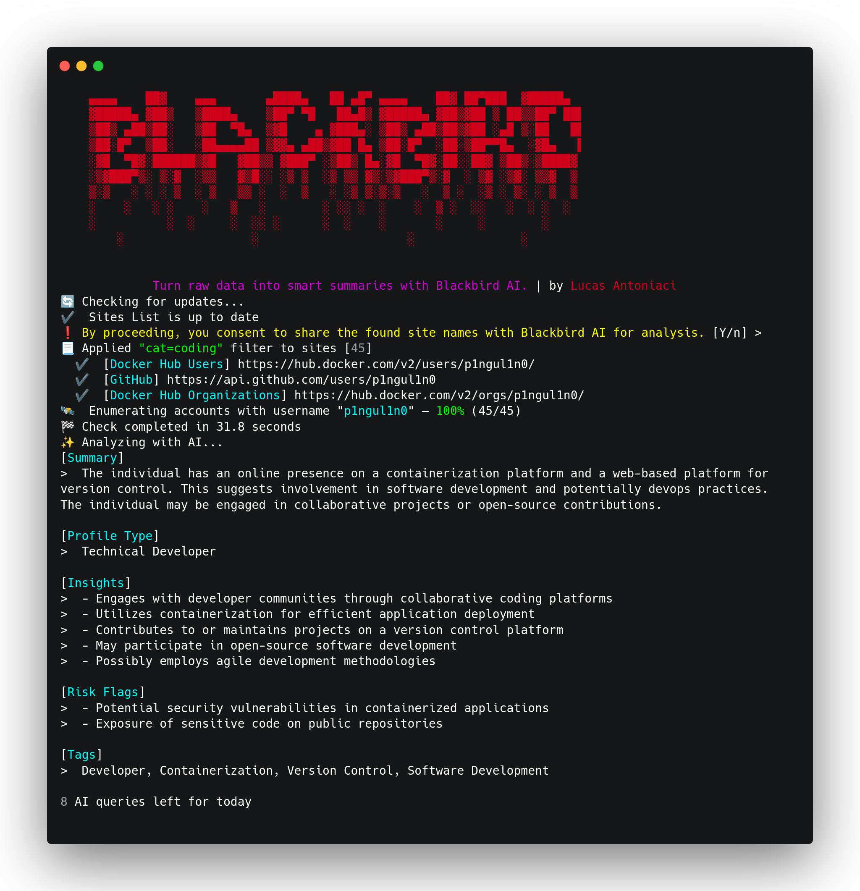

# Blackbird

<figure><figcaption></figcaption></figure>


# Blackbird — OSINT Username & Email Reconnaissance Tool

Blackbird checks a given username or email address against hundreds of sites
(social, gaming, coding, dating, finance, and more) to find where an account
exists. When it finds a match on Instagram, it can also pull additional
metadata (obfuscated email/phone) if you provide a valid, logged-in session.

This copy includes a set of fixes and additions on top of the original
project — see [Changes in This Copy](#changes-in-this-copy) below.

---

## Quick Start

```bash
cd blackbird
pip install -r requirements.txt
python blackbird.py
```

Running it with no arguments launches **interactive mode** — it will ask you:

1. Whether to search a **username** or an **email**
2. The target(s) to search (comma-separated for multiple)
3. Whether to filter to a specific category or site
4. Whether to export a PDF/CSV report
5. For your **Instagram session ID**, if you want enhanced metadata (email/phone)

You'll then see a live progress bar, followed by a results table **grouped by
category** (social, coding, gaming, etc.), with any extra Instagram metadata
shown in its own column.

---

## Command-Line Usage

You don't have to use interactive mode — all the original flags still work:

```bash
# Search a single username across all sites
python blackbird.py -u ted

# Search multiple usernames
python blackbird.py -u ted alice bob

# Search a username, restricted to one category
python blackbird.py -u ted --filter "cat=social"

# Search a username, restricted to a specific site (partial match)
python blackbird.py -u ted --filter "name~Instagram"

# Search an email
python blackbird.py -e ted@example.com

# Export results
python blackbird.py -u ted --pdf --csv --json

# See how many sites/categories are currently loaded
python blackbird.py --stats
```

Run `python blackbird.py -h` for the full flag list.

### Filter syntax

`--filter` takes `property=value` (or `~`, `>`, `<`, `>=`, `<=`, `!=`)
expressions, combinable with `and`/`or`:

```
--filter "cat=social"
--filter "name~Instagram"
--filter "cat=social and name~insta"
```

Valid categories (see `--stats` for the live, current list): `social`,
`gaming`, `coding`, `tech`, `hobby`, `misc`, `finance`, `business`,
`shopping`, `images`, `music`, `blog`, `art`, `dating`, `political`, `news`,
`video`, `archived`, `health`, plus `xx NSFW xx` (excluded automatically with
`--no-nsfw`).

---

## Instagram Enhanced Metadata (Email/Phone)

Instagram's public profile page doesn't expose email/phone, but Instagram's
own "forgot password" style lookup does, obfuscated (e.g. `t***@gmail.com`).
Blackbird can use this — but only with a **valid, logged-in session cookie**
belonging to your own Instagram account.

### Getting your session ID

1. Log in to instagram.com in a browser, using your own account.
2. Open DevTools (`F12`) → **Application** tab → **Cookies** → `instagram.com`.
3. Copy the value of the cookie named `sessionid`.
4. Either:
   - Paste it in when the app **prompts you** for it (recommended — no file
     to manage), or
   - Save it permanently in a `.env` file in the repo root:
     ```env
     INSTAGRAM_SESSION_ID=your_real_sessionid_value_here
     API_URL=https://ai.blackbird.run
     ```

**This value is equivalent to a login credential for your account.** Don't
share it, commit it to version control, or paste it anywhere public. It also
expires/rotates periodically — if enhanced lookups stop working, get a fresh
one.

### Reading the warnings

| Message | Meaning | Fix |
|---|---|---|
| `INSTAGRAM_SESSION_ID is not set` | No session ID configured | Provide one when prompted, or add it to `.env` |
| `Session rejected (HTTP 401/403)` | Session expired or invalid | Log in again, grab a fresh `sessionid` |
| `Enhanced metadata lookup failed` | Ran but returned nothing | Re-run with `--verbose`; refresh session ID |
| `Unexpected response... no user data returned` | Account private/nonexistent, or Instagram changed its API | Verify manually |

---

## Site Coverage

Blackbird's site list is pulled live from the open-source
[WhatsMyName project](https://github.com/WebBreacher/WhatsMyName) and updates
automatically on every run (unless you pass `--no-update`), so it's always
tracking the current upstream list rather than a fixed, aging snapshot.

Run `python blackbird.py --stats` at any time to see the current total and a
per-category breakdown.

---

## Exporting Results

| Flag | Output |
|---|---|
| `--pdf` | PDF report |
| `--csv` | CSV file |
| `--json` | JSON file |
| `--dump` | Saves raw HTML of each found page |

Exports are written to a folder named `<target>_<date>_blackbird/` in the
repo root.

---

## Changes in This Copy

Fixes and additions made on top of the upstream project:

- **Interactive terminal app mode** — running `python blackbird.py` with no
  arguments now launches a guided menu (search type → target → filters →
  export options → Instagram session), instead of requiring you to already
  know the CLI flags.
- **Categorized results table** — every search (interactive or CLI) now ends
  with a table grouped by category, with a dedicated column for any
  Instagram email/phone metadata recovered.
- **Fixed a crash** (`AttributeError: 'list' object has no attribute
  'strip'`) that occurred when Instagram metadata values came back as a list
  instead of a plain string — the results table now handles strings, lists,
  dicts, and `None` values safely, and a rendering issue in the table can no
  longer crash a search that already succeeded.
- **Fixed a crash** (`IndexError: list index out of range`) that occurred
  when `--filter` (or the interactive filter prompt) was given a malformed
  value, e.g. typing a bare site name like `Instagram` instead of
  `name=Instagram`. Malformed filters now show a clear error instead of
  crashing, and the interactive prompt auto-converts a bare word into a
  `name~value` filter.
- **Instagram session ID is no longer silently skipped** — if it's missing
  or has expired, the console now tells you exactly which case it is
  (missing / rejected / malformed response) instead of quietly falling back
  to username-only results.
- **Interactive session ID prompt** — if `INSTAGRAM_SESSION_ID` isn't set in
  `.env`, the app asks for it directly at runtime (only when running in a
  real interactive terminal; scripted/piped runs skip it automatically
  rather than hanging).
- **`--stats` flag** — see current site/category counts at a glance.
- This README.

---

## Legal & Ethical Use

This tool is for OSINT research on accounts and information you are
authorized to look into — for example, your own accounts, accounts you have
explicit consent to test, or authorized security assessments. Your
`INSTAGRAM_SESSION_ID` is your own account's live credential; treat it
accordingly, and use this tool in line with the Terms of Service of every
site it queries.
